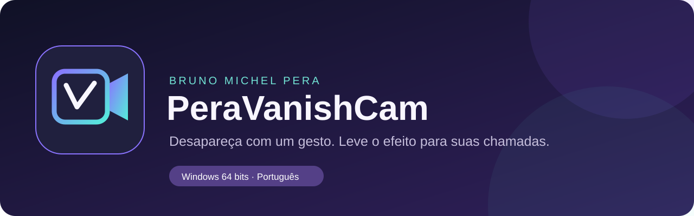

# PeraVanishCam

<p align="center">
  <a href="https://github.com/perabru/PeraVanishCam/releases/latest/download/PeraVanishCam.exe"></a>
</p>
<p align="center"><strong>Download direto · Windows 64 bits · Não precisa instalar Python</strong><br>
<a href="https://github.com/perabru/PeraVanishCam/releases/latest/download/PeraVanishCam.exe"><strong>Clique aqui para baixar PeraVanishCam.exe</strong></a> · <a href="https://github.com/perabru/PeraVanishCam/releases/latest/download/PeraVanishCam-Windows-x64.zip">Pacote ZIP com os guias</a></p>

<p align="center"></p>

**Versão mantida e personalizada por Bruno Michel Pera.** Efeitos de desaparecimento, clones ao vivo e substituição em tronco, com fumaça animada, gestos e som personalizado.

[Baixar o executável (.exe)](https://github.com/perabru/PeraVanishCam/releases/latest/download/PeraVanishCam.exe) · [Instalar e começar](docs/INSTALACAO_E_USO.md) · [Usar no Google Meet](GUIA_GOOGLE_MEET_PTBR.md) · [Novos gestos ninja](docs/GESTOS_NINJA.md) · [Apoiar com Pix](#apoie-com-pix)

## Começar em cinco passos

1. Clique em **[BAIXAR EXECUTÁVEL PARA WINDOWS (.EXE)](https://github.com/perabru/PeraVanishCam/releases/latest/download/PeraVanishCam.exe)** no início desta página.
2. Abra **PeraVanishCam.exe** com dois cliques. A versão pronta não precisa de Python. Se preferir o pacote ZIP com os guias, extraia todos os arquivos antes de abrir.
3. Escolha **1 — Normal**, **2 — Naruto** ou **3 — Clones das Sombras**.
4. Saia do enquadramento por **4 segundos** para capturar o fundo. Depois volte.
5. Faça o gesto do modo escolhido ou pressione **V** na janela da câmera.

| Modo / selo | Como ativar | Efeito |
| --- | --- | --- |
| Normal | Indicador e médio formando V | Desaparecimento gradual |
| Naruto | Palmas juntas, dedos lado a lado, duas mãos visíveis | Fumaça, tronco e som ao desaparecer |
| Clones das Sombras | Indicador e médio das duas mãos formando uma cruz (+), por 0,65 s | Dois clones ao vivo surgem com fumaça, um de cada lado |
| Selo do Tigre, no modo Clones | Indicador e médio juntos nas duas mãos, lado a lado e para cima, por 0,65 s | Fumaça e substituição em tronco |

O vídeo é processado no seu computador. O aplicativo não grava a câmera nem envia suas imagens para servidores. Depois de baixar o executável, os modelos necessários já estão no pacote.

## Novos selos ninja

**[Veja o guia ilustrado dos gestos](docs/GESTOS_NINJA.md).** No modo **3 — Clones das Sombras**, use o selo cruzado para criar clones ou o selo do Tigre para desaparecer em um tronco. Use **C** para clones, **T** para tronco, **R** para voltar e **H** para abrir o guia visual. Abaixe as mãos entre um selo e outro.

A fumaça envolve a entrada dos efeitos e se dissipa. O tronco cai e permanece no cenário até você reaparecer. A captura solicita **1280 × 720 a 30 FPS**, conforme o suporte da sua webcam, com recorte mais suave e melhor preservação das bordas. Veja [como ajustar a resolução](docs/INSTALACAO_E_USO.md#qualidade-da-imagem).

## Efeitos realistas

- **Fumaça com textura realista:** expansão, turbulência interna, transparência e dissipação em 1,8 segundo. Camadas passam atrás e à frente dos clones e do tronco.
- **Tronco inspirado no Naruto:** silhueta quase vertical com dois galhos quebrados, casca e anéis da madeira fotorealistas, queda com pequeno rebote, ajuste de luminosidade ao ambiente e sombra ao tocar a base do quadro.
- **Clones com contorno estável:** o fluxo óptico acompanha o movimento entre as leituras da segmentação e reduz a tremulação das bordas. Rosto e roupa continuam vindo do quadro atual da webcam.

O processamento usa **MediaPipe, OpenCV e NumPy**, sem serviço de IA na nuvem. As camadas de fumaça são reutilizadas entre os clones para reduzir o custo de processamento. A fluidez depende do computador; 720p é o ponto de partida recomendado.

## Instalar e usar

- **[Guia de instalação e uso](docs/INSTALACAO_E_USO.md):** requisitos, primeira execução, teclas, câmera, som e soluções comuns.
- **[Guia do Google Meet](GUIA_GOOGLE_MEET_PTBR.md):** imagem com OBS Virtual Camera; voz e efeito sonoro juntos com Voicemeeter Banana.
- **[Leia-me do pacote Windows](LEIA-ME-WINDOWS.txt):** instruções rápidas para acompanhar o executável.

| Tecla | Ação |
| --- | --- |
| V | Ativar o efeito selecionado |
| C / T | Clones / tronco no modo 3 |
| H | Guia dos selos no modo 3 |
| R | Reaparecer |
| Espaço | Capturar novamente o fundo; saia do quadro por 4 segundos |
| F | Alternar tela cheia |
| Q ou Esc | Fechar e liberar a câmera |

Clique na janela da câmera antes de usar as teclas. Mantenha a câmera parada depois de capturar o cenário.

## Personalizar o som

Coloque **som.mp3** ou **som.wav** na mesma pasta de **PeraVanishCam.exe** e reabra o aplicativo. O arquivo será utilizado nos efeitos de tronco e clones. Se os dois existirem, o MP3 tem prioridade. Remova ou renomeie o arquivo para voltar ao som padrão.

Use **TESTAR_SOM.bat** para testar o áudio sem abrir a câmera.

```powershell
.\PeraVanishCam.exe --mode naruto --som "C:\Sons\meu-efeito.mp3"
.\PeraVanishCam.exe --teste-som
```

## Google Meet

Para a imagem, instale [OBS Studio](https://obsproject.com/download), deixe o OBS fechado, abra o PeraVanishCam e escolha **OBS Virtual Camera** em **Meet → Configurações → Vídeo → Câmera**.

Para transmitir **sua voz e o efeito sonoro juntos**, siga o [guia de áudio e vídeo](GUIA_GOOGLE_MEET_PTBR.md). Ele mostra os dispositivos de entrada e saída do Voicemeeter Banana e a configuração para evitar eco.

<a id="apoie-com-pix"></a>

## Apoie o projeto com Pix

Se o **PeraVanishCam** foi útil para você, considere apoiar a manutenção e as próximas melhorias. **A contribuição é opcional e qualquer valor ajuda.** Você pode usar o aplicativo sem contribuir.

| Pix | Informação |
| --- | --- |
| Tipo de chave | E-mail |
| Chave | **bruno.pera@unifesp.br** |
| Responsável por esta versão | Bruno Michel Pera |
| Valor | Livre |

Copie a chave:

```text
bruno.pera@unifesp.br
```

No aplicativo do seu banco, abra **Pix → Transferir → Chave e-mail**, cole a chave e confira os dados do destinatário antes de confirmar. Obrigado por apoiar o desenvolvimento!

## Executar e compilar pelo código-fonte

Instale Python 3.11 de 64 bits. No Windows, abra **INICIAR.bat**. O script prepara um ambiente isolado na pasta do projeto. Na primeira execução, as dependências e os modelos necessários são baixados.

```powershell
py -3.11 -m venv .venv-local
.\.venv-local\Scripts\python.exe -m pip install -r requirements.txt
.\.venv-local\Scripts\python.exe vanish_cam.py
```

Para gerar **PeraVanishCam.exe** no Windows, use **BUILD_WINDOWS.bat**. O fluxo de GitHub Actions também testa o código, os modelos, a decodificação do áudio, os efeitos e o executável antes de disponibilizar o pacote em Releases.

Os scripts selecionam **Python 3.11 de 64 bits**, a mesma versão usada na compilação publicada. Se já existir uma pasta `.venv-local` criada com outra versão de Python, renomeie essa pasta e abra **INICIAR.bat** novamente para preparar o ambiente correto.

## Origem e créditos

Esta edição deriva de [Nicovic17/vanish_webcam](https://github.com/Nicovic17/vanish_webcam), com continuidade a partir de [perabru/vanish_webcam](https://github.com/perabru/vanish_webcam). **A personalização, os guias em português e a manutenção desta edição são de Bruno Michel Pera.** O código e os recursos da base mantêm seus créditos originais.

Veja [ORIGEM.md](ORIGEM.md) e [assets/README.md](assets/README.md). Apoio ao autor original: [PayPal](https://paypal.me/nicovic17) ou [Revolut](https://revolut.me/nicoauriemma).
