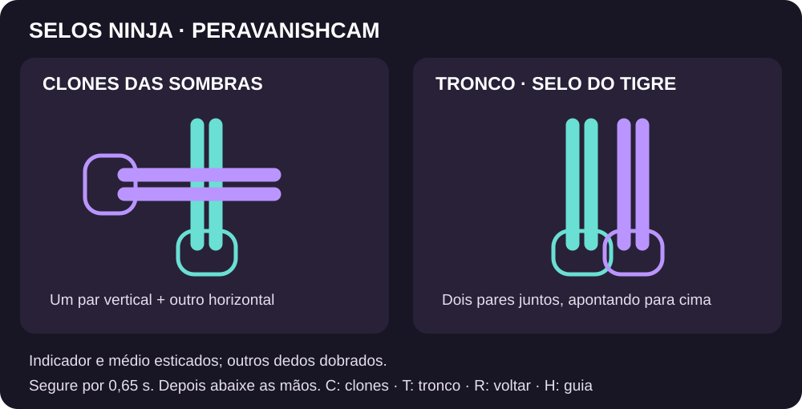

# Clones das Sombras e Transformação



No menu inicial, escolha **3 — Clones das Sombras** ou **4 — Transformação**. Nos dois modos, os dois novos selos ficam disponíveis; a opção do menu define o efeito inicial da tecla V.

1. Saia do enquadramento por **4 segundos** para capturar o fundo.
2. Volte para o centro da imagem e mantenha as duas mãos bem iluminadas e visíveis.
3. Faça o selo e segure por **0,65 segundo**.
4. Abaixe ou separe as mãos antes de repetir outro selo. Isso evita ativações acidentais.

## Clones das Sombras — selo cruzado (+)

Estique **indicador e médio de cada mão** e dobre os outros dedos. Mantenha uma dupla de dedos na vertical e a outra na horizontal, formando uma cruz à frente do peito. Deixe as palmas um pouco separadas, para que a câmera consiga ver as duas mãos.

Você permanece no centro e surgem **dois clones ao vivo**, um de cada lado. Eles acompanham a imagem capturada pela sua câmera. A aparição tem fumaça e o efeito sonoro configurado.

## Transformação — selo do Tigre

Estique **indicador e médio juntos nas duas mãos**, dobre os outros dedos e aproxime as mãos lado a lado, com as duas duplas de dedos apontando para cima. Mantenha o selo por 0,65 segundo.

Sua silhueta é substituída por uma **personagem feminina original de anime**, com transição de fumaça. O avatar acompanha a posição da sua silhueta na imagem.

As poses são inspiradas no anime e adaptadas para manter as duas mãos visíveis à webcam. Evite esconder completamente uma mão atrás da outra ou cruzar os braços.

## Atalhos dos modos 3 e 4

Clique na janela da câmera antes de usar o teclado.

| Tecla | Ação |
| --- | --- |
| C | Criar os clones imediatamente |
| T | Transformar na personagem imediatamente |
| V | Repetir o efeito selecionado |
| R | Voltar à sua imagem normal |
| H | Abrir ou fechar o guia visual dos selos |
| Espaço | Capturar o fundo novamente |
| F | Alternar tela cheia |
| Q ou Esc | Fechar |

Os gestos e as teclas acionam o mesmo efeito. A janela de ajuda fica separada do vídeo e não aparece na câmera virtual.

## Usar outro avatar

Feche o programa, coloque uma imagem **personagem.png**, com fundo transparente, na mesma pasta de `PeraVanishCam.exe` e abra-o novamente. Para voltar ao avatar incluído, remova ou renomeie esse arquivo.

Também é possível indicar outro arquivo:

```powershell
.\PeraVanishCam.exe --mode transform --personagem "C:\Imagens\minha-personagem.png"
.\PeraVanishCam.exe --mode clones
```

O áudio personalizado continua funcionando com `som.mp3`, `som.wav` ou a opção `--som`.

## Usar no Google Meet

A imagem dos clones e da transformação segue pela mesma **OBS Virtual Camera**. Para enviar o efeito sonoro junto com sua voz, siga o [guia do Google Meet](../GUIA_GOOGLE_MEET_PTBR.md).

## Se o selo não for reconhecido

- Mostre as duas mãos inteiras, sem aproximá-las demais da câmera.
- Use uma fonte de luz à frente de você e um fundo estável.
- Mantenha indicador e médio visíveis; dobre anelar e mínimo.
- Segure o selo sem mexer por 0,65 segundo e abaixe as mãos antes da próxima tentativa.
- Pressione **H** para ver o guia ou use **C/T** para testar os efeitos pelo teclado.
